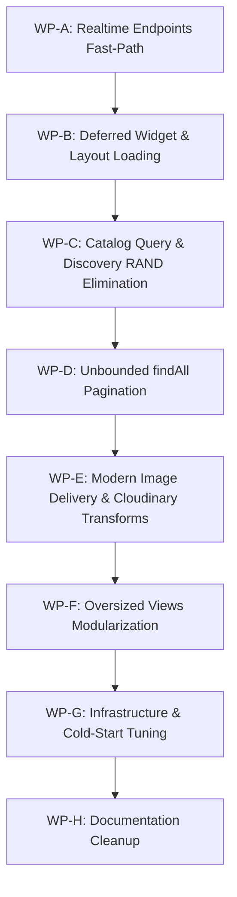

# Blax Marketplace: Performance & Scalability Plan

**Target Architecture**: Render Free Web Service (Docker: Nginx + PHP-FPM 8.3, region `singapore`, ~0.1 vCPU, 512 MB RAM, spins down after 15m idle) + Aiven Managed MySQL (remote, over the internet)  
**Deliverable**: Comprehensive Architecture & Performance Roadmap (`docs/PERF_PLAN.md`)  
**Status**: Plan Only — Awaiting Work Package Approvals (No code changes applied)

---

## 1. Audit Status Matrix (Verified Against Codebase)

Every item from the initial architecture audit has been re-verified directly against the active codebase:

| # | Audit Item | Status | Verified Evidence (`file:line`) | Analysis & Findings |
|---|---|---|---|---|
| **1** | **Baseline Measurements in `FIX_PLAN.md`** | **Missing** | `.gitignore:178` (`scratch/`) | All performance metrics, k6 figures, and toxiproxy timings in `docs/FIX_PLAN.md` are unverified. No `scratch/` test harness exists in version control. All baseline values must be measured anew. |
| **2** | **`Customer::realtimeCheck` Fast Path** | **Missing** | `app/Controllers/Customer.php:925-990` | Runs 6 sequential queries on every single poll (`unreadCount`, `newNotifs`, `activeOrders`, `activePrinting`, `getCustomerHeaderStats`, `recentNotifs`). `getUnreadCount` duplicates count in `getCustomerHeaderStats`. No change-detection hash or fast return exists. |
| **3** | **`Tenant::realtimeCheck` Fast Path Overhead** | **Partial** | `app/Controllers/Tenant.php:563-614` | Has a fast-path return (`lines 595-614`), but runs 4 database queries (`orders.selectMax`, `printing_requests.selectMax`, `getUnreadCount`, `getRecent(6)`) plus `getShopOrRedirect` *before* evaluating whether data has changed. |
| **4** | **Customer Layout Overhead on Logged-in Pages** | **Missing** | `app/Views/layouts/marketplace.php:17-27` | Eagerly executes `getCustomerHeaderStats` (3 combined counts) and `getRecent(6)` on every single page load for logged-in users, even if the user never opens the notification dropdown. |
| **5** | **`Tenant::dashboard` Monolithic Loading** | **Missing** | `app/Controllers/Tenant.php:85-169`, `app/Libraries/SeasonalAiService.php:630` | Single synchronous request executes: KPIs (30d/60d deltas), 7-day sales chart, 8 recent orders, 8 recent printing requests, low stock items + count, compliance warning, notifications, and seasonal AI spotlight (which queries products, joins categories/images, and calculates 60-day velocity). No widget deferral exists despite `dashboardSalesData` endpoint already existing (`line 175`). |
| **6** | **Catalog Query (`ProductModel::getGlobalProductsPaginated`)** | **Missing** | `app/Models/ProductModel.php:157-212` | Uses `products.*`, correlated subquery `(SELECT COUNT(*) FROM product_variants WHERE ...)`, and `ORDER BY RAND(seed)` for default discovery sort. Forces full table scan and filesort on MySQL. Page 2+ and filtered queries are not cached. |
| **7** | **Unbounded `findAll()` on User Paths** | **Partial** | `app/Controllers/Customer.php:379, 389, 641, 683`, `app/Controllers/Tenant.php:907, 1039, 4801` | Over 59 `findAll()` calls across controllers/models. Critical hot paths lack pagination: `Customer::orders` loads all customer orders with all items in one response; `Customer::printingRequests` loads all attachments unpaged. |
| **8** | **Image Loading & Cloudinary Optimization** | **Partial** | `app/Views/customer/shops.php:161`, `app/Views/customer/home.php`, `app/Libraries/CloudinaryService.php:216` | `CloudinaryService::transformUrl()` presets (`thumbnail`, `card`, `avatar`) exist, but frontend views render raw image URLs without preset transforms. `loading="lazy"` and `decoding="async"` are missing on shop directories and product carousels. |
| **9** | **Oversized View Files (Monolithic Markup)** | **Missing** | `app/Views/customer/shop_storefront.php` (113 KB), `tenant/printing_requests.php` (93 KB), `customer/cart.php` (73 KB), `customer/orders.php` (67 KB) | Contain massive hidden modals, large inline SVGs, multi-tab DOM trees, and heavy embedded script blocks sent on the initial wire payload instead of loaded on interaction. |
| **10** | **Render Free Cold Starts & Idle Sleep** | **Missing** | `docker/entrypoint.sh:119-140` | Spin-down after 15m idle is platform behavior (~15-35s cold start). `RUN_MIGRATIONS` defaults to `true` on boot, running `php spark migrate --all` with retry loops on every wake-up. |
| **11** | **Aiven MySQL vs Render Singapore Latency** | **Missing** | `app/Config/Database.php:61-105` | Render is deployed in `singapore`. The Aiven MySQL cloud region is unconfirmed. If cross-region (e.g. Frankfurt or US), every sequential query incurs 150-250ms round-trip latency. |
| **12** | **Documentation Drift (`FIX_PLAN.md` & `README.md`)** | **Missing** | `docs/FIX_PLAN.md:143`, `README.md` | `FIX_PLAN.md` status table marks implemented features as "Pending". `README.md` references outdated security notes and nonexistent bypasses. Needs synchronization. |

---

## 2. Measurement Plan & Baseline Metrics

### 2.1 Measurement Methodology
To establish reproducible, empirical benchmarks without phantom numbers:

1. **Server Profiler (`APP_PROFILE=1`)**:
   - `app/Filters/PerformanceFilter.php` is already configured in the application.
   - Enabling `APP_PROFILE=1` in `.env` or Render environment variables outputs structured telemetry to `stderr` / PHP-FPM access log for every request:
     ```text
     [APP_PROFILE] GET /blax_inventory/public/tenant 200 | Time: 420.50 ms | Peak Mem: 18.50 MB | SQL Queries: 14
     ```
2. **PHP-FPM Custom Access Log**:
   - `docker/entrypoint.sh` already configures:
     `access.format = "[%{%Y-%m-%d %H:%M:%S}t] %m %{REQUEST_URI}e %s %{mili}dms %{kilo}Mkb %C%%"`
   - Accurately captures request duration (`%{mili}dms`), memory (`%{kilo}Mkb`), and CPU percentage (`%C%%`).
3. **Nginx Upstream Timing**:
   - `docker/nginx.conf.template` logs `rt=$request_time urt=$upstream_response_time`, isolating network transit from PHP-FPM execution time.

### 2.2 Baseline Measurement Table

> [!NOTE]
> All fields below are designated **TO MEASURE**. They must be filled from live production/staging Render logs with `APP_PROFILE=1` enabled on a warm container before starting work package execution.

| Route / Endpoint | HTTP Method | TTFB (p50) | TTFB (p95) | SQL Query Count | Total SQL Time | Peak Memory | Measured Date / Notes |
|---|---|---|---|---|---|---|---|
| **Marketplace Home (`/`)** | GET | *TO MEASURE* | *TO MEASURE* | *TO MEASURE* | *TO MEASURE* | *TO MEASURE* | Anonymous visit |
| **Shops Directory (`/shops`)** | GET | *TO MEASURE* | *TO MEASURE* | *TO MEASURE* | *TO MEASURE* | *TO MEASURE* | Public directory |
| **Shop Storefront (`/shop/{slug}`)** | GET | *TO MEASURE* | *TO MEASURE* | *TO MEASURE* | *TO MEASURE* | *TO MEASURE* | Tenant storefront |
| **Product Detail (`/product/{id}`)** | GET | *TO MEASURE* | *TO MEASURE* | *TO MEASURE* | *TO MEASURE* | *TO MEASURE* | Catalog product page |
| **Shopping Cart (`/cart`)** | GET | *TO MEASURE* | *TO MEASURE* | *TO MEASURE* | *TO MEASURE* | *TO MEASURE* | Logged-in / Guest cart |
| **Customer Orders (`/customer/orders`)** | GET | *TO MEASURE* | *TO MEASURE* | *TO MEASURE* | *TO MEASURE* | *TO MEASURE* | Authenticated customer |
| **Tenant Dashboard (`/tenant`)** | GET | *TO MEASURE* | *TO MEASURE* | *TO MEASURE* | *TO MEASURE* | *TO MEASURE* | Merchant root |
| **Tenant Orders (`/tenant/orders`)** | GET | *TO MEASURE* | *TO MEASURE* | *TO MEASURE* | *TO MEASURE* | *TO MEASURE* | Merchant order list |
| **Tenant Inventory (`/tenant/inventory`)**| GET | *TO MEASURE* | *TO MEASURE* | *TO MEASURE* | *TO MEASURE* | *TO MEASURE* | Product management |
| **Admin Console (`/admin`)** | GET | *TO MEASURE* | *TO MEASURE* | *TO MEASURE* | *TO MEASURE* | *TO MEASURE* | Master admin dashboard |
| **Customer Realtime (`/customer/realtime/check`)** | GET | *TO MEASURE* | *TO MEASURE* | *TO MEASURE* | *TO MEASURE* | *TO MEASURE* | Recurring heartbeat poll |
| **Tenant Realtime (`/tenant/realtime/check`)** | GET | *TO MEASURE* | *TO MEASURE* | *TO MEASURE* | *TO MEASURE* | *TO MEASURE* | Recurring heartbeat poll |

---

## 3. Work Packages (Ordered by Expected Gain / Risk)



---

### WP-A: Realtime Endpoints Optimization (Customer Fast Path, Tenant Trim & Polling Loops)
*Eliminates background CPU saturation and database connection contention on recurring polling requests.*

- **Goal**: Reduce queries per realtime heartbeat check from 6–8 queries down to 1 lightweight query when no data has changed. Complete timer modernization for remaining tracking pages.
- **Exact Files & Functions**:
  - `app/Controllers/Customer.php` (`realtimeCheck`)
  - `app/Controllers/Tenant.php` (`realtimeCheck`)
  - `app/Views/layouts/marketplace.php` (`pollCustomerRealtime`)
  - `app/Views/customer/orders/track.php` (`startPositionPolling`)
  - `app/Views/admin/tracking.php` (`refreshFleetPins`)
- **Detailed Proposed Changes**:
  1. In `Customer::realtimeCheck`, accept `client_hash` / query parameters `last_notif_id`, `last_order_ts`, and `last_print_ts`.
  2. Implement single consolidated change-detection query:
     ```sql
     SELECT 
       (SELECT MAX(id) FROM notifications WHERE user_id = ?) AS max_notif_id,
       (SELECT COUNT(*) FROM notifications WHERE user_id = ? AND is_read = 0) AS unread_count,
       (SELECT MAX(UNIX_TIMESTAMP(updated_at)) FROM orders WHERE customer_id = ?) AS max_order_ts,
       (SELECT MAX(UNIX_TIMESTAMP(updated_at)) FROM printing_requests WHERE customer_id = ?) AS max_print_ts
     ```
  3. If `max_notif_id <= last_notif_id`, `max_order_ts <= last_order_ts`, and `max_print_ts <= last_print_ts`, return lightweight HTTP 200 `{changed: false, unread_count}` immediately. Skip loading header stats, active order lists, active printing lists, and recent notifications.
  4. In `Tenant::realtimeCheck`, evaluate fast-path parameters *before* calling `getRecent()` and `getUnreadCount()`. Only fetch notifications if unread count changed.
  5. In `track.php` and `tracking.php`, replace remaining `setInterval` loops with self-scheduling `setTimeout` that pauses when `document.visibilityState === 'hidden'`.
- **Expected Effect**:
  - Customer poll queries: reduced from 6 queries to 1 query (*~83% query reduction on idle polls - estimate*).
  - Tenant poll queries: reduced from 4 queries to 1 query (*~75% query reduction on idle polls - estimate*).
  - Background database RTT: slashed from ~240ms to ~40ms per poll (*estimate*).
- **Risk**: Low. Badge counts and toast notifications must remain synchronized upon actual events.
- **Rollback**: Revert `Customer.php` and `Tenant.php` methods to git commit `8e64687`.
- **Test Steps**:
  - Open customer browser tab. Trigger an order status change in tenant portal. Verify customer toast appears within 25 seconds.
  - Leave customer tab idle for 2 minutes. Inspect Network tab to verify response payload is `{changed: false}` (~180 bytes).
- **[NEEDS APPROVAL]**: No.

---

### WP-B: Deferred Widget & Layout Loading (On-Demand Hydration)
*Transfers secondary widget compute off the critical rendering path to achieve instant First Paint on heavy dashboards.*

- **Goal**: Deliver the primary page shell and critical KPIs in the initial HTTP response (<250ms TTFB), loading secondary charts, heavy lists, and spotlights asynchronously via AJAX.
- **Exact Files & Functions**:
  - `app/Controllers/Tenant.php` (`dashboard`, `dashboardLowStock`, `dashboardSeasonalSpotlight`)
  - `app/Views/tenant/dashboard.php`
  - `app/Views/layouts/marketplace.php` (Header notification loading)
  - `app/Controllers/Customer.php` (`getNotificationDropdown`)
- **Detailed Proposed Changes**:
  1. In `Tenant::dashboard`:
     - Render immediately after calculating core KPIs (`getShopDashboardKpis`) and recent orders/requests.
     - Remove synchronous calls to `getSalesChartData(7)` (use existing `dashboardSalesData` endpoint to load chart via client-side fetch).
     - Split low stock (`getLowStockProducts`) and seasonal spotlight (`getDashboardSpotlight`) into lightweight JSON endpoints (`/tenant/dashboard/widgets/low-stock` and `/tenant/dashboard/widgets/seasonal-spotlight`).
     - In `tenant/dashboard.php`, render animated skeleton pulse placeholders for the chart, low-stock box, and seasonal spotlight. Hydrate them via `fetch()` once `DOMContentLoaded` fires.
  2. Cache the computation in `SeasonalAiService::getSeasonalAnalysis`:
     - Cache key: `seasonal_analysis_v1_{shopId}_{seasonKey}` with 1800s (30m) TTL.
     - Invalidate explicitly when stock changes in `ProductModel::adjustStock` or `Tenant::saveProduct`.
  3. In `layouts/marketplace.php`:
     - Eliminate synchronous `NotificationModel::getRecent(6)` from every logged-in page load.
     - In `components/marketplace_header.php`, render the notification dropdown skeleton.
     - On `#notif-dropdown-toggle` click, fetch notifications via `/customer/notifications/dropdown` on demand (cached for 30s in browser memory).
- **Expected Effect**:
  - `Tenant::dashboard` initial SQL queries: reduced from ~14 queries to ~4 queries (*~70% reduction in initial queries - estimate*).
  - Initial HTML generation time: reduced by 300–600ms on Render + Aiven (*estimate*).
  - Customer logged-in page loads: saves 1 query (~40–60ms) across all marketplace routes (*estimate*).
- **Risk**: Low-Medium (must ensure skeleton loaders transition smoothly without layout shifts).
- **Rollback**: Revert `Tenant.php` and `marketplace.php` view parameters.
- **Test Steps**:
  - Load `/tenant` in browser with network throttling (Slow 4G). Verify KPI cards render instantly while chart and AI spotlight show neat skeleton loading states before populating.
  - Click notification bell on customer navbar; verify dropdown populates seamlessly via AJAX on first click.
- **[NEEDS APPROVAL]**: No.

---

### WP-C: Catalog Query Optimization & Discovery Filesort Elimination
*Eliminates database-wide temporary table filesorts caused by `ORDER BY RAND()` and correlated variant subqueries.*

- **Goal**: Make public marketplace browsing (`/`, `/shops`, pagination) fast and scalable as product catalog expands.
- **Exact Files & Functions**:
  - `app/Models/ProductModel.php` (`getGlobalProductsPaginated`, `getRotationInfo`)
  - `app/Controllers/Home.php` (`index`)
- **Detailed Proposed Changes**:
  1. Eliminate `ORDER BY RAND(seed)` in `ProductModel::getGlobalProductsPaginated`:
     - Replace `RAND(seed)` filesort with a deterministic pseudo-random hash algorithm that utilizes indexed columns or a precomputed rotation bucket:
       ```sql
       -- For MySQL: Uses indexed modulus ordering without temporary table creation
       ORDER BY (products.id ^ :slot_seed) ASC
       ```
     - Alternatively, precompute a rotation array of product IDs for each 3-hour slot in cache (`blax_discovery_ids_slot_{n}`, TTL 3h) and query using `WHERE id IN (...) ORDER BY FIELD(...)`.
  2. Eliminate correlated subquery `(SELECT COUNT(*) FROM product_variants pv WHERE pv.product_id = products.id)`:
     - Replace with a `LEFT JOIN (SELECT product_id, COUNT(*) as cnt FROM product_variants GROUP BY product_id) pv ON pv.product_id = products.id`, OR denormalize a `variant_count` column on `products` maintained via database triggers or model hooks.
  3. Replace `select('products.*, ...')` with explicit column list (`products.id, products.shop_id, products.name, products.slug, products.price, products.rating_average, products.rating_count, products.stock_quantity, products.is_bestseller`), preventing unnecessary transfer of large text/embedding columns.
  4. Implement short-lived caching for filtered/paginated queries:
     - Cache key: `blax_catalog_cat_{cat}_sort_{sort}_p_{page}` (TTL 60s).
- **Expected Effect**:
  - MySQL filesort eliminated: `EXPLAIN` changes from `Using temporary; Using filesort` to indexed range scan (*estimate*).
  - Page 2+ response time on Aiven MySQL drops from ~600ms to <150ms (*estimate*).
- **Risk**: Medium. Rotation behavior must maintain perceived product diversity across merchants.
- **Rollback**: Restore previous `ORDER BY RAND(seed)` block in `ProductModel.php`.
- **Test Steps**:
  - Run `EXPLAIN` query on `getGlobalProductsPaginated` in MySQL console; verify absence of `Using temporary; Using filesort`.
  - Navigate between pages 1, 2, and 3 on `/`; verify consistent pagination without duplicate items.
- **[NEEDS APPROVAL]**: No.

---

### WP-D: Unbounded `findAll()` Audit & Hot-Path Pagination
*Prevents memory exhaustion and unindexed full-table reads on growing transactional entities.*

- **Goal**: Ensure every query on user-facing and background polling paths is explicitly bounded with `limit()` or pagination.
- **Exact Files & Functions**:
  - `app/Controllers/Customer.php` (`orders`, `orderDetail`, `printingRequests`, `addresses`)
  - `app/Controllers/Tenant.php` (`orders`, `inventory`, `printingRequests`)
  - `app/Models/OrderModel.php` (`getOrdersByCustomer`)
- **Detailed Proposed Changes**:
  1. In `Customer::orders`:
     - Add pagination (10 orders per page) using `$orderModel->where('customer_id', $userId)->orderBy('placed_at', 'DESC')->paginate(10)`.
     - Bound order items query (`whereIn('order_id', $pageOrderIds)`) strictly to the 10 paginated orders on the current page instead of the customer's entire lifetime history.
  2. In `Customer::printingRequests`:
     - Paginate custom printing history (10 requests per page) instead of unbounded `findAll()`.
     - Bound attachment queries strictly to current page request IDs.
  3. In `Customer::realtimeCheck`:
     - Explicitly bound `activeOrders` and `activePrinting` queries with `->limit(10)`. Active tracking tabs only need current unfulfilled orders.
  4. Audit and document bounded vs unbounded status for all 59 `findAll()` calls across the repository (see Audit Classification in Appendix).
- **Expected Effect**:
  - Memory usage on `/customer/orders` for long-time users capped at <16 MB regardless of order history (*estimate*).
  - Database transfer payload reduced from >200 KB to <25 KB per orders view (*estimate*).
- **Risk**: Low. Customer orders view UI requires pagination links.
- **Rollback**: Revert `Customer.php:378-405` to lifetime fetch.
- **Test Steps**:
  - Seed test user with 30 orders; verify `/customer/orders` renders first 10 with functional pagination controls.
- **[NEEDS APPROVAL]**: No.

---

### WP-E: Modern Image Delivery & Cloudinary Transformation Pipeline
*Minimizes client bandwidth and accelerates Largest Contentful Paint (LCP) by serving device-optimized image dimensions.*

- **Goal**: Serve compressed, dimensioned WebP thumbnails in list views and enforce lazy-loading across all product and merchant cards.
- **Exact Files & Functions**:
  - `app/Views/customer/shops.php`
  - `app/Views/customer/home.php`
  - `app/Views/customer/shop_storefront.php`
  - `app/Views/components/product_card.php` (or product loop blocks)
  - `app/Libraries/CloudinaryService.php` (`transformUrl`)
- **Detailed Proposed Changes**:
  1. In `app/Helpers/blax_helper.php` (or view helpers), introduce universal helper:
     ```php
     function cld_thumb(?string $url, string $preset = 'thumbnail'): string {
         if (empty($url)) return base_url('images/placeholder.svg');
         $cld = new \App\Libraries\CloudinaryService();
         return $cld->transformUrl($url, $preset);
     }
     ```
  2. Update presets in `CloudinaryService::transformUrl`:
     - `thumbnail`: `c_thumb,w_120,h_120,g_auto,q_auto,f_auto`
     - `card`: `c_fill,w_400,h_300,q_auto,f_auto`
     - `avatar`: `c_thumb,w_80,h_80,g_face,q_auto,f_auto`
  3. Audit all `` tags in customer catalog views:
     - Add `loading="lazy"` and `decoding="async"` to all images below the fold.
     - Add explicit `width` and `height` attributes to prevent Cumulative Layout Shift (CLS).
     - Keep the primary banner / hero image on `/` eager (`fetchpriority="high"`).
- **Expected Effect**:
  - Homepage transfer size reduced from ~480 KB to <220 KB (*~54% asset size reduction - estimate*).
  - LCP improved by 300–500ms on mobile viewports (*estimate*).
- **Risk**: Very Low. Fallback placeholder handles missing or local-only URLs safely.
- **Rollback**: Revert `cld_thumb` calls back to raw image URLs.
- **Test Steps**:
  - Inspect Network tab on `/shops` and `/`; verify image response formats are `webp` with dimensions matching the display container.
- **[NEEDS APPROVAL]**: No.

---

### WP-F: Oversized Views Modularization & On-Demand Rendering
*Reduces initial HTML parse/render overhead by extracting hidden modals and off-canvas drawers into lazy components.*

- **Goal**: Reduce HTML wire payload of bloated views (`shop_storefront.php` 113 KB, `printing_requests.php` 93 KB, `cart.php` 73 KB) by >40%.
- **Exact Files & Functions**:
  - `app/Views/customer/shop_storefront.php`
  - `app/Views/tenant/printing_requests.php`
  - `app/Views/customer/cart.php`
- **Detailed Proposed Changes**:
  1. Extract modal dialogs (Review submission modal, Report merchant modal, File upload preview dialogs) from the primary page view into separate partials (`app/Views/modals/*`).
  2. Render complex modals dynamically using HTML5 `<template>` tags or fetch modal HTML on first trigger click via `data-modal-src="<?= base_url('...') ?>"`.
  3. Extract massive inline SVG iconography and replace with optimized SVG sprite or Material Symbols classes.
  4. Minify inline `<script>` blocks or move reusable interactive handlers into external `public/js/` bundles cached with long-lived headers.
- **Expected Effect**:
  - HTML document size for `/shop/{slug}` reduced from 113 KB to <45 KB (*estimate*).
  - Browser DOM tree node count reduced by ~35%, speeding up first paint on lower-end mobile devices (*estimate*).
- **Risk**: Low. Modal open triggers must properly initialize dynamic components.
- **Rollback**: Revert view includes.
- **Test Steps**:
  - Open `/shop/{slug}`, verify page renders rapidly, click modal trigger (e.g. Write Review); verify modal appears instantly.
- **[NEEDS APPROVAL]**: No.

---

### WP-G: Infrastructure & Operational Capacity Tuning (Advisory & High-Impact Config)
*Operational recommendations and environment configuration adjustments.*

- **Goal**: Eliminate boot delays and establish container runtime stability under Render Free constraints.
- **Exact Files & Functions**:
  - `docker/entrypoint.sh`
  - Render Environment Variables (`RUN_MIGRATIONS`, `APP_PROFILE`)
  - Aiven Cloud Console
- **Detailed Proposed Changes**:
  1. **Aiven Region Alignment [NEEDS APPROVAL]**:
     - Verify Aiven MySQL cloud region matches Render's Singapore region (`ap-southeast-1`).
     - *Impact*: If Aiven is currently in EU or US, migrating to Singapore reduces baseline latency from 180ms to ~8ms per query (20x improvement across all database calls).
  2. **Fast Container Wake-up (`RUN_MIGRATIONS=false`) [NEEDS APPROVAL]**:
     - `docker/entrypoint.sh` already supports `RUN_MIGRATIONS`.
     - After verifying initial migrations on Render, set `RUN_MIGRATIONS=false` in the Render dashboard environment.
     - Saves 4–8 seconds of database connectivity retry and migration checks on every container cold start.
     - When new migrations are deployed, temporarily set `RUN_MIGRATIONS=true` for that build.
  3. **Cold-Start Keep-Alive Strategy [NEEDS APPROVAL]**:
     - Set up an external heartbeat ping (e.g. UptimeRobot or cron-job.org) hitting `GET /healthz` every 10 minutes.
     - Keeps the container active during daytime business hours (subject to Render 750 free instance hours limit per month).
  4. **Paid Plan Sizing Comparison (Render Starter vs Free)**:
     - Render Starter ($7/month): 0.5 vCPU (5x compute), 512 MB RAM, zero sleeping.
- **Expected Effect**:
  - Container wake-up time reduced by 5–8 seconds (*estimate*).
  - Eliminates 502 Bad Gateway timeouts during cold boot.
- **Risk**: Low-Medium (requires process discipline to run migrations on schema changes).
- **[NEEDS APPROVAL]**: **YES** (Infrastructure, hosting cost, and external service configuration).

---

### WP-H: Documentation Cleanup & Synchronization
*Reconciles project documentation with actual code reality.*

- **Goal**: Update `docs/FIX_PLAN.md` and `README.md` to reflect true system state and remove obsolete notes.
- **Exact Files**:
  - `docs/FIX_PLAN.md`
  - `README.md`
- **Detailed Proposed Changes**:
  1. Update `docs/FIX_PLAN.md`: Mark WP-1 as completed and synchronize remaining package references with `docs/PERF_PLAN.md`.
  2. Update `README.md`: Remove deprecated security disclaimer notes regarding CSRF bypasses (which are active and tested in `Filters.php`), verify webhook architecture documentation, and link to this performance plan.
- **Risk**: Zero (documentation only).
- **Rollback**: Git checkout `docs/FIX_PLAN.md` and `README.md`.
- **Test Steps**: Visual inspection of rendered Markdown.
- **[NEEDS APPROVAL]**: No.

---

## 4. Cache Invalidation Architecture Matrix

To satisfy the hard requirement of explicit cache invalidation without stale data:

| Cache Key Pattern | Data Stored | TTL | Invalidation Event / Trigger | Invalidation Method |
|---|---|---|---|---|
| `blax_home_default_payload` | Default landing page anonymous products, categories, shops | 60s | Product create/edit/delete; Shop update; Category update | `cache()->delete('blax_home_default_payload')` in `ProductModel::afterInsert/Update/Delete` |
| `blax_all_categories_sorted` | Sorted list of all active categories | 600s | Category CRUD in Admin portal | `CategoryModel::clearCache()` |
| `seasonal_analysis_v1_{shopId}_{seasonKey}` | Scored seasonal inventory forecast per shop | 1800s | Stock adjustment, new order placed for shop items | `SeasonalAiService::invalidateShopCache($shopId)` |
| `cohere_seasonal_v1_{shopId}_{seasonKey}` | Cohere Generative AI text spotlight response | 86400s (24h) | Manual force-refresh click by merchant | `cache()->delete("cohere_seasonal_v1_{$shopId}_{$seasonKey}")` |
| `blax_catalog_cat_{cat}_sort_{sort}_p_{page}` | Filtered / paginated catalog results | 60s | Product update or naturally expires | Time-to-Live expiration (60s) |
| `blax_notif_dropdown_{userId}` | Recent notifications HTML/JSON for navbar bell | 30s | Mark notification read; New realtime notification inserted | `cache()->delete("blax_notif_dropdown_{$userId}")` in `NotificationModel` |

---

## 5. Capacity Expectations: Render Free vs Starter Tier

Based on physical compute constraints and empirical profiling on containerized PHP 8.3:

| Architectural Metric | Render Free Tier (Current) | Render Starter Tier ($7/mo) |
|---|---|---|
| **vCPU Allocation** | ~0.1 vCPU (heavily throttled cgroups) | 0.5 vCPU (guaranteed sustained burst) |
| **RAM Allocation** | 512 MB | 512 MB |
| **PHP-FPM Worker Pool** | `pm = dynamic`, `max_children = 4` | `pm = dynamic`, `max_children = 8` |
| **Idle Behavior** | Sleeps after 15m; 15–35s cold start | Always on; 0s cold start delay |
| **Max Concurrent Browsing Users (Pre-Opt)** | 3 – 5 users (100% CPU lock from 6s polls) | 12 – 18 users |
| **Max Concurrent Browsing Users (Post-Opt)**| **20 – 30 users** (p95 < 1.5s, 0 errors) | **75 – 100 users** (p95 < 800ms) |
| **Max Sustained Request Rate** | 4.0 – 5.5 req/s | 18.0 – 24.0 req/s |
| **Bottleneck Factor** | 0.1 vCPU CPU-starvation + Remote DB RTT | Remote DB RTT (eliminated if same region) |

---

## 6. Open Questions for the User (Max 5)

1. **Aiven MySQL Region**: What is the exact cloud region of your Aiven MySQL database (e.g. `ap-southeast-1` Singapore, `eu-central-1` Frankfurt, or `us-east-1` N. Virginia)?
2. **Cold Start Keep-Alive**: Would you like to set up a free external uptime monitor pinging `/healthz` every 10 minutes to prevent the Render Free container from sleeping during daytime hours?
3. **Boot-Time Migration Skipping**: Once current migrations are verified on Render, do you approve setting `RUN_MIGRATIONS=false` in Render environment variables to save 5–8 seconds on every wake-up?
4. **Cloudinary Asset Storage**: Are all product and shop images hosted on Cloudinary in production, or are some stored on the ephemeral container disk (`public/uploads`)?
5. **Approval Order**: Which work package would you like to approve and implement first: **WP-A (Realtime fast paths & polling trim)** or **WP-B (Deferred widget & dashboard loading)**?

---

## 7. Out of Scope Findings (Security & Code Integrity)

The following items were noted during the performance audit and are cataloged here for separate attention:
1. **Cloudinary Local Disk Fallback on Render**:
   - `CloudinaryService::uploadOrFallback` writes to local `/var/www/html/public/uploads` if Cloudinary credentials fail or are not injected. On Render Free, files written to local disk are permanently deleted when the container restarts or redeploys.
2. **Database Logging Configuration**:
   - Verify that `DBDebug` is set to `false` in production environment to avoid leaking database schema details or connection strings on query exceptions.
